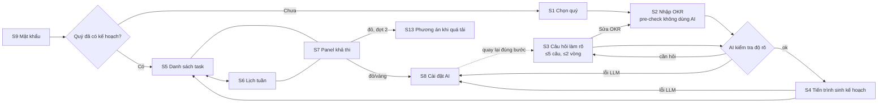
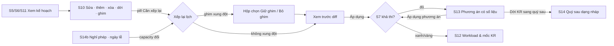

# OKR Planner — UX flow & wireframe

Tài liệu UX cho [THA-3725](/THA/issues/THA-3725) (task cha [THA-3724](/THA/issues/THA-3724), plan bản 3). Wireframe mid-fidelity, song ngữ vi/en, desktop + mobile.

## Cách xem

| Nội dung | File |
|---|---|
| Wireframe đợt 1 — luồng MVP (S1–S9) | [`wireframes/wave1.html`](wireframes/wave1.html) |
| Wireframe đợt 2 — hoàn thiện GĐ1 (S10–S14) | [`wireframes/wave2.html`](wireframes/wave2.html) |
| Spec từng màn đợt 1 (component, trạng thái, AC) | [`spec-wave1.md`](spec-wave1.md) |
| Spec từng màn đợt 2 | [`spec-wave2.md`](spec-wave2.md) |
| Bảng nhãn vi/en (sinh tự động) | [`i18n-labels.md`](i18n-labels.md) |
| Ảnh PNG từng màn | [`png/vi/`](png/vi/), [`png/en/`](png/en/) |
| Công cụ render / trích nhãn | [`tools/render.py`](tools/render.py), [`tools/extract_labels.py`](tools/extract_labels.py) |

Mở file HTML trực tiếp bằng trình duyệt (không cần server). Nút **VI / EN** ở góc phải đổi toàn bộ nhãn; thêm `?lang=en` vào URL để mở sẵn tiếng Anh. Mỗi màn gồm: frame desktop 1440, frame mobile 390 (khi có), các frame trạng thái (rỗng, đang tải, lỗi, quá tải) và khung **Ghi chú** đánh số khớp với chấm hồng trên frame.

Render lại ảnh và bảng nhãn sau khi sửa wireframe:

```bash
python3 docs/ux/tools/render.py          # PNG vi + en, báo lỗi nếu còn nhãn chưa dịch
python3 docs/ux/tools/extract_labels.py  # cập nhật i18n-labels.md
```

Nhãn trong HTML viết dạng `tiếng Việt¦English` (hoặc `{vi¦en}` khi một câu có nhiều nhãn); `wf.js` chọn ngôn ngữ khi hiển thị.

## Luồng MVP



Lần đầu dùng là wizard 5 bước có stepper (Chọn quý · Nhập OKR · Làm rõ · Sinh kế hoạch · Kế hoạch) để giảm lựa chọn ở mỗi bước (Hick's Law) và cho cảm giác tiến gần đích (Goal-Gradient). Sau khi có kế hoạch, người dùng ở trong app shell. Sơ đồ đầy đủ có nhánh lỗi: ảnh `png/vi/wave1-flow.png`.

## Luồng đợt 2 (vòng lặp chỉnh kế hoạch)



Nguyên tắc đợt 2: sửa không tốn AI; mọi thay đổi lịch có xem trước và hoàn tác; chỉ scheduler quyết định ngày (không phải LLM); không có thay đổi nào âm thầm dời task của người dùng. Ảnh: `png/vi/wave2-flow.png`.

## Kiến trúc thông tin

- **Desktop** (sidebar): Kế hoạch OKR · Công việc (Danh sách / Lịch tuần / Lịch tháng) · Lịch · Workload* · Quản lý quý* · Cài đặt · Chính sách dữ liệu. (*đợt 2)
- **Topbar** mọi màn: chọn quý · pill trạng thái khả thi · VI/EN · Đăng xuất.
- **Mobile** (tab bar đáy, vùng ngón cái): OKR · Công việc · Lịch · Cài đặt. Từ đợt 2 tab cuối đổi thành **Thêm** (Workload · Quản lý quý · Cài đặt · Chính sách dữ liệu), vẫn giữ 4 tab.
- **Breakpoint** theo nội dung: `<768` mobile · `768–1279` sidebar icon, panel khả thi thành popover từ pill · `≥1280` sidebar + rail khả thi 320px.

## Design system: map sang shadcn/ui

Nguồn token là `frontend/src/app/globals.css` (shadcn/ui style `radix-nova`, base `neutral`, đã có `--success`, `--success-muted`, `--warning`, `--warning-muted`). Wireframe dùng đúng các tên này (`--background`, `--foreground`, `--muted`, `--primary`, `--destructive`, `--border`, `--input`, `--ring`, `--radius`, `--chart-1..5`); giá trị hex trong `wf.css` chỉ để vẽ wireframe.

- Nền cảnh báo đỏ: `bg-destructive/10` (không cần token mới).
- Banner thông tin (xanh dương trong wireframe): dùng `Alert` mặc định; màu xanh dương chỉ để phân biệt trong wireframe, không bắt buộc thêm token.

**Màu Objective `--chart-1..5`** (CTO đã chốt, đã có trong `globals.css`): 5 màu phân loại indigo, cyan, fuchsia, orange, lime thay cho 5 sắc xám của theme neutral. Giá trị nằm trong gam sRGB nên tương phản không phụ thuộc cách trình duyệt ánh xạ màu; test `frontend/src/app/theme-tokens.test.ts` kiểm tra gam màu, tương phản chữ trắng ≥ 4.5:1 và 5 sắc cách nhau ≥ 30°.

| Token | Objective | Light | Dark |
|---|---|---|---|
| `--chart-1` | O1 · indigo | `oklch(0.56 0.245 277)` ≈ `#5b53ff` · 5.1:1 | `oklch(0.58 0.232 277)` ≈ `#605eff` · 4.6:1 |
| `--chart-2` | O2 · cyan | `oklch(0.535 0.099 223)` ≈ `#037997` · 5.0:1 | `oklch(0.555 0.103 223)` ≈ `#027f9f` · 4.6:1 |
| `--chart-3` | O3 · fuchsia | `oklch(0.58 0.274 323)` ≈ `#c000d4` · 5.0:1 | `oklch(0.6 0.283 323)` ≈ `#c901de` · 4.6:1 |
| `--chart-4` | O4 · orange | `oklch(0.56 0.172 41)` ≈ `#c34601` · 5.0:1 | `oklch(0.58 0.178 41)` ≈ `#cc4901` · 4.6:1 |
| `--chart-5` | O5 · lime | `oklch(0.53 0.147 132)` ≈ `#4a7c00` · 5.0:1 | `oklch(0.55 0.152 132)` ≈ `#4e8302` · 4.6:1 |

Tỉ lệ là tương phản chữ trắng trên nền token. Bản dark sáng hơn một chút để nổi trên nền tối (≥ 3.5:1 so với `--card`, đạt ngưỡng 3:1 cho đồ họa) mà vẫn giữ chữ trắng ≥ 4.5:1. Code dùng `var(--chart-N)` / class `bg-chart-N`, không hard-code hex; Objective thứ 6 trở đi quay vòng về `--chart-1`. Hex trong `wireframes/wf.css` là bản nháp của UX (vài màu chưa đạt 4.5:1), không dùng cho code.

**Thay đổi design system đề xuất** (cần CTO/Frontend chấp nhận):

| Token | Đề xuất | Dùng cho | Lý do |
|---|---|---|---|
| `--pattern-off` | sọc xám 135° | Ngày nghỉ trên lịch | Phân biệt không chỉ bằng màu |
| `--pattern-buffer` | sọc vàng nhạt 135° (dựa trên `--warning-muted`) | Vùng buffer 10% | Như trên |
| `--pattern-holiday`, `--pattern-leave` | sọc hồng nhạt / xanh nhạt 135° | Ngày lễ, nghỉ phép trên lịch tháng (đợt 2) | Lịch tháng cần phân biệt 4 loại ngày không làm việc; ô luôn kèm tên + "0h" |

Màu Objective luôn kèm mã `O1…O5`.

**Component** — đã có trong `frontend/src/components/ui`: `AlertDialog`, `Alert`, `Badge`, `Button`, `Card`, `Field`, `Input`, `Label`, `RadioGroup`, `Select`, `Separator`, `Skeleton`, `Spinner`, `Switch`.
Cần thêm bằng `npx shadcn add` (đều là component chuẩn): `tabs`, `table`, `sheet` (drawer chi tiết task), `drawer` (bottom sheet mobile), `collapsible`/`accordion`, `toggle-group`, `checkbox`, `textarea`, `progress`, `popover`, `dropdown-menu`, `sonner` (toast có Hoàn tác), `calendar` (date picker), `command` (combobox chọn model / phụ thuộc), `tooltip`, `dialog`.
Lịch: FullCalendar `dayGridWeek`, `dayGridMonth`. Biểu đồ: Recharts `ComposedChart` (Bar xếp chồng + Line capacity).

**Component mới (tổ hợp)**: `FeasibilityPanel` + `FeasibilityPill` (S7), `OkrObjectiveCard` + `KrRow` (S2), `TaskTree` (S5), `DayCapacityHeader` + `TaskBlock` (S6/S11). Đợt 2: `TaskRowMenu` + `TaskEditSheet` + `PendingChangesBar` (S10), `PinConflictDialog` + `RescheduleDiffDialog` (S10), `MonthDayCell` + `UnscheduledTray` (S11), `WeeklyLoadChart` + `KrMilestoneTable` (S12), `OverloadOptionCard` + `OptionPreviewPanel` + `AiScopeReviewDialog` (S13), `QuarterCard`, `LeaveForm`, `HolidayTable`, `ExportDialog`, `ProviderPolicyCallout` (S14). Đều ghép từ component shadcn, không cần primitive mới.

**Thang**: spacing 4/8/12/16/20/24/32; cỡ chữ 12/13/14/16/20/24; bo góc 6 (control), 8 (card), 12 (dialog).

## Mẫu trạng thái dùng chung

| Trạng thái | Mẫu |
|---|---|
| Rỗng | Khung viền đứt + tiêu đề nói điều gì đang thiếu + 1 hành động chính |
| Đang tải | `Skeleton` đúng hình nội dung; việc > 1s có chữ mô tả; việc AI có thời gian đã chạy + khoảng kỳ vọng |
| Lỗi | `Alert` đỏ: tiêu đề nêu điều gì hỏng · nguyên nhân cụ thể · cách sửa · `Thử lại`. Không mất dữ liệu người dùng đã nhập |
| Quá tải | Pill + panel S7 đỏ, task không kịp gắn "× Không kịp", luôn hiển thị số giờ thiếu và KR bị ảnh hưởng; đợt 2 có panel phương án S13 |
| Hành động phá hủy | Xóa có thể hoàn tác → `Toast` "Hoàn tác" 8s, dừng đếm khi rê chuột/focus; không hoàn tác được (xóa quý) → `AlertDialog` gõ tên quý; xóa toàn bộ dữ liệu → nhập lại mật khẩu |
| Kế hoạch lỗi thời | Sau sửa task / nghỉ phép / ngày lễ: pill "⟳ Cần xếp lại" thay cho pill khả thi (không hiện số cũ), badge "N thay đổi", nút "Xếp lại lịch" |

## Accessibility (bắt buộc cho Frontend)

- Trạng thái khả thi, trạng thái quý, trạng thái task: luôn có **chữ + ký hiệu**, không chỉ màu (WCAG 1.4.1). Chữ trên nền `-bg` đạt ≥ 4.5:1.
- Vùng bấm ≥ 44×44 trên mobile, ≥ 32 trên desktop (nút `sm` 28px chỉ dùng trong bảng dày đặc có hàng cao 40).
- Mọi kéo-thả (sắp xếp Objective, dời task trên lịch) có phương án bàn phím/menu.
- Panel khả thi `role="status"` + `aria-live="polite"`; tiến trình S4 `role="progressbar"` có `aria-valuenow`.
- Tôn trọng `prefers-reduced-motion` (tắt shimmer skeleton, chuyển cảnh).
- Không có timeout ép người dùng (trừ khóa đăng nhập, có đếm ngược).

## Quyết định UX còn mở (cần CEO/board chốt)

| # | Câu hỏi | Đề xuất UX | Ảnh hưởng nếu chọn khác |
|---|---|---|---|
| D1 | **Ưu tiên Objective nghiêm ngặt hay xen kẽ?** (plan mục 10.5 mặc định nghiêm ngặt) | Nghiêm ngặt làm Objective ưu tiên thấp bắt đầu rất muộn: trong dữ liệu mẫu, "Đạt JLPT N4" chỉ bắt đầu từ 02/11 dù là việc cần học đều. Đề xuất: MVP giữ nghiêm ngặt nhưng S5 hiện rõ ngày bắt đầu của từng Objective; thêm tùy chọn "xen kẽ theo trọng số" ở đợt 2 (công tắc trong Cài đặt). | Nếu chọn xen kẽ ngay từ MVP, lịch tuần nhiều màu hơn, nhưng panel S13 phải giải thích lại "bỏ KR ưu tiên thấp" giải phóng giờ ra sao |
| D2 | **Provider mặc định khi không tìm thấy Ollama** (plan mặc định: OpenAI) | Không tự chọn OpenAI. Hiện "Chưa cấu hình AI" và yêu cầu người dùng chọn; chọn OpenAI phải qua hộp đồng ý gửi dữ liệu (S8). Nhất quán với nguyên tắc "không tự gửi dữ liệu ra ngoài". | Tự chọn OpenAI thì nhanh hơn một bước nhưng dữ liệu có thể rời máy khi người dùng chưa biết |
| D3 | **Câu hỏi làm rõ không bắt buộc bị bỏ qua** thì sao? | Cho bỏ qua; task liên quan gắn nhãn "Giả định chưa xác nhận". Câu bắt buộc (thiếu số liệu) không bỏ qua được. Tối đa 2 vòng hỏi. | Chặn hoàn toàn thì chắc chắn hơn nhưng dễ kẹt người dùng |
| D4 | **Lưu cài đặt lịch có tự xếp lại không?** | Một nút "Lưu & xếp lại lịch" kèm xem trước ảnh hưởng. Đợt 2: nếu đụng task ghim thì qua hộp xác nhận S10. | Tách 2 bước thì người dùng dễ quên xếp lại và nhìn lịch cũ |
| D5 | **Làm tròn buffer 10%** theo ngày hay theo giờ? | **Đã chốt (CTO): làm tròn lên theo ngày.** Buffer là số ngày làm việc ít nhất tính từ cuối quý có tổng capacity ≥ 10% S. API trả `buffer_start` (ngày đầu buffer) và `buffered_supply_minutes` = capacity các ngày trước `buffer_start`, nên giờ buffer = `supply_minutes − buffered_supply_minutes`. Q4/2026 mặc định: S = 260h, buffer 7 ngày = 28h từ 23/12, S đã trừ buffer = 232h; bật Thứ 7 4h (S13): S = 312h, buffer 8 ngày = 32h từ 23/12. Fixture Frontend dùng đúng các số này. | — |
| D6 | **Kết hợp nhiều phương án khi quá tải** (S13) | Cho chọn nhiều phương án, xem trước tổng hợp rồi áp dụng một lần, có "Hoàn tác". | Chỉ áp dụng từng phương án thì đơn giản hơn nhưng người dùng phải lặp nhiều lần vì quá tải xảy ra thường xuyên |
| D7 | **Hiện ước tính chi phí khi dùng OpenAI** trước khi sinh kế hoạch? | Có, một dòng nhỏ ở S3/S4 ("≈0,05 USD cho lần sinh này"), đợt 2. | Không có thì người dùng khó kiểm soát chi phí |
| D8 | **Mốc KR dạng số tính thế nào?** (S12) | Mặc định nội suy theo giờ task đã xong của KR, ghi rõ "mức kỳ vọng, không phải dự báo"; KR là chỉ số trễ (WAU, doanh thu) gắn nhãn "Chỉ số trễ"; cho đổi từng KR sang "tuyến tính theo thời gian" hoặc "tự nhập". | Chỉ dùng tiến độ task: KR 1.1 hiện "2.000 WAU cuối tháng 10" chỉ vì task xong 14/10, dễ gây hiểu sai. Chỉ dùng tuyến tính: bỏ qua việc task dồn đầu/cuối quý |
| D9 | **Xếp lại tự động sau mỗi lần sửa hay gom lại?** (S10) | Gom: sửa chỉ đánh dấu "Cần xếp lại", người dùng bấm "Xếp lại lịch" và xem diff trước khi áp dụng. | Tự động: ngày của hàng chục task nhảy sau mỗi lần sửa, người dùng mất phương hướng và khó hoàn tác |
| D10 | **Kéo-thả trên lịch có tự ghim không?** (S10/S11) | Có: kéo = "tôi muốn làm ngày này" → dời + ghim, toast có Hoàn tác và "Xếp lại ngay". | Không ghim: lần xếp lại sau có thể kéo task về chỗ cũ, người dùng thấy thao tác "không ăn" |
| D11 | **Dời KR sang quý sau có tự tạo quý nháp không?** (S13 → S14) | Có: tạo Q1/2027 dạng nháp chứa KR được dời, hiện trên thẻ quý. Quý sau dùng ngày lễ dự kiến (Tết 2027 còn "dự kiến"). | Không tạo: KR "biến mất" khỏi quý hiện tại, người dùng phải nhớ tự nhập lại |
| D12 | **Quý đã kết thúc có cho sửa không?** (S14) | Chỉ đọc, trừ ô "Kết quả cuối" của KR; cho "Sao chép KR chưa đạt sang quý khác". | Cho sửa: số liệu review bị đổi ngược, mất giá trị so sánh |
| D13 | **Có nút "Xóa toàn bộ dữ liệu" không?** (S14c) | Có, nhưng phải nhập lại mật khẩu truy cập + gợi ý xuất trước. Vì mật khẩu dùng chung, ai có mật khẩu đều xóa được — board cân nhắc bỏ hẳn nút này ở GĐ1. | Bỏ: người dùng chỉ xóa được từng quý; giữ không có xác nhận mạnh: rủi ro mất dữ liệu |
